# Network Traffic Analysis with Wireshark

## Project Overview

This project focuses on capturing and analyzing real network traffic using Wireshark. As a Computer Information Systems student interested in IT and cybersecurity, I wanted to better understand how computers communicate over networks and how security analysts investigate network activity.

I used Wireshark on my Windows PC to examine DNS requests, TCP connections, encrypted TLS traffic, and network statistics.

## Tools Used

- Wireshark
- Windows
- Ethernet connection
- Wireshark display filters
- Protocol Hierarchy and Conversations statistics

## Network Traffic Analysis

### 1. Packet Capture

Captured network traffic from my Ethernet connection and examined packet information, including source and destination addresses, protocols, ports, and packet lengths.

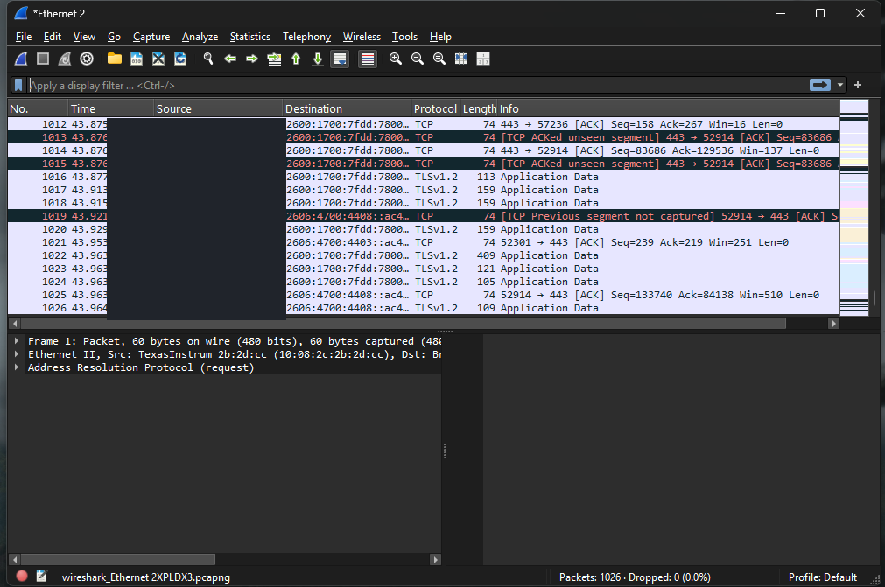

### 2. DNS Analysis

Used Wireshark's DNS filter to identify domain name queries and examine how devices request IP address information.

Also inspected multicast DNS (mDNS) responses used for local network device discovery.

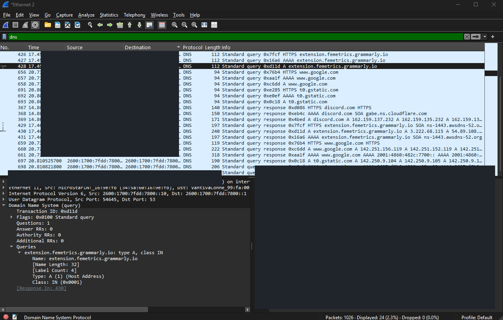

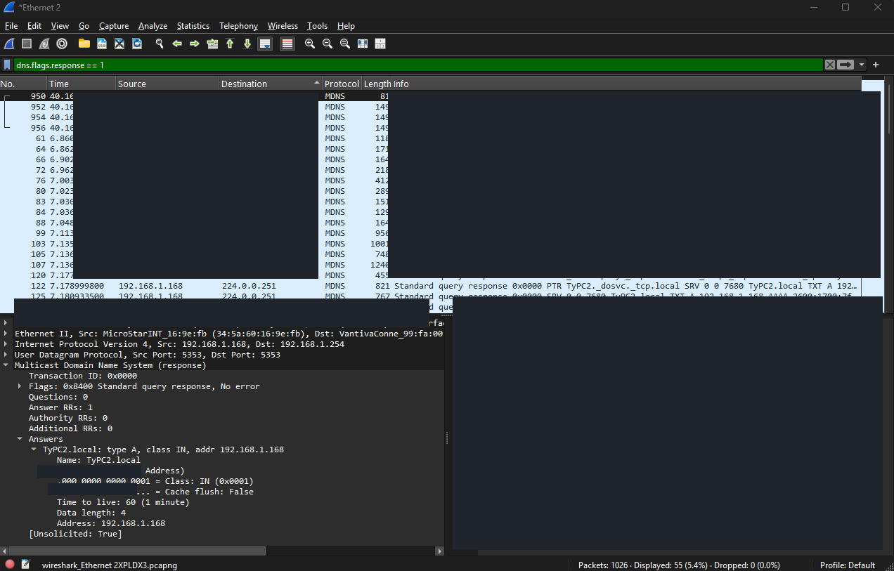

### 3. TCP Three-Way Handshake

Identified and analyzed the three packets involved in establishing a TCP connection:

- SYN: Initiates a connection.
- SYN-ACK: Responds to and acknowledges the request.
- ACK: Completes the handshake.

Used the display filter `tcp.stream == 11` to isolate a TCP conversation and inspect its packets.

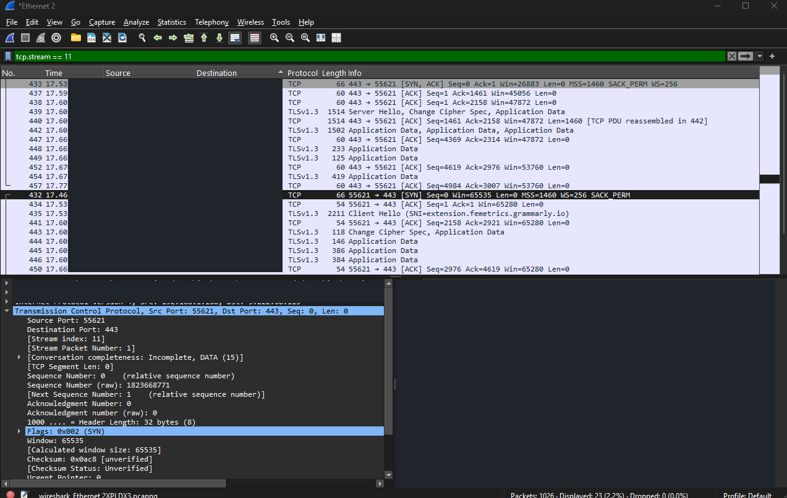

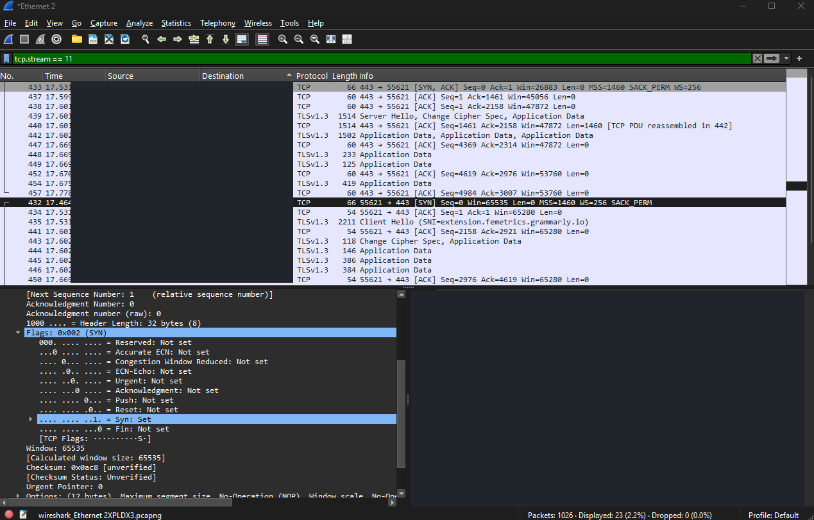

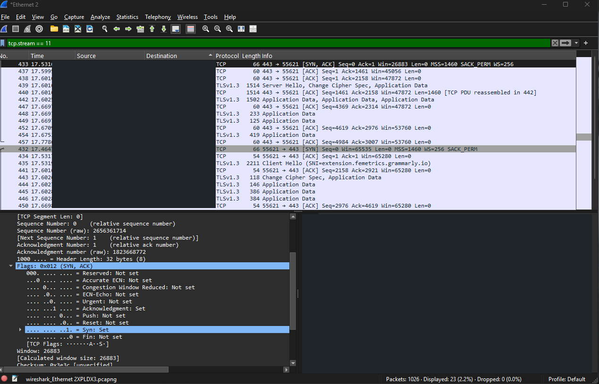

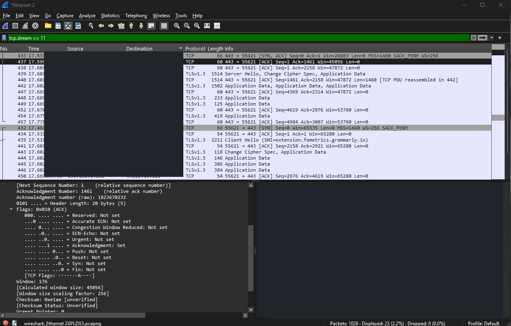

### 4. TLS and Encrypted Traffic

Analyzed TLS packets to understand how secure network communication is established.

Identified a TLS Client Hello message and examined encrypted Application Data.

Learned that while TLS protects transmitted content, network analysts can still observe certain connection details.

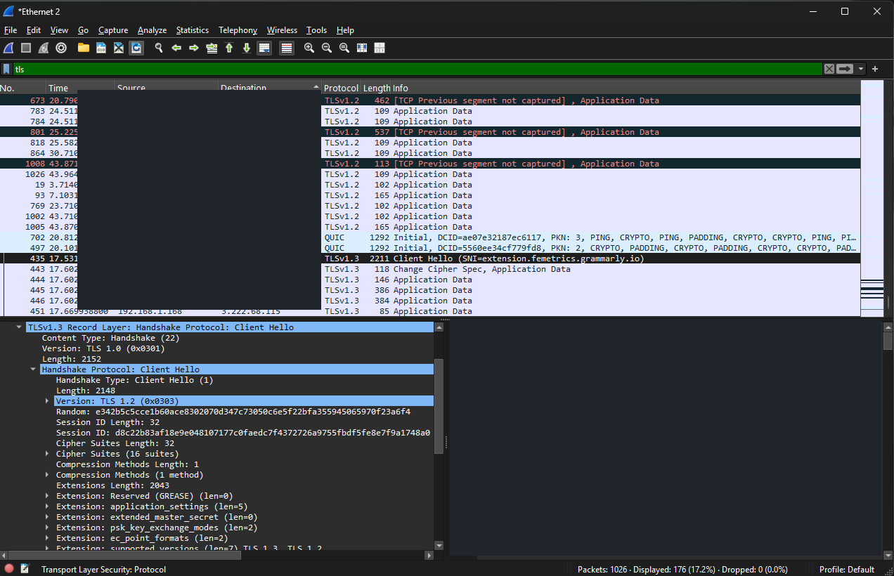

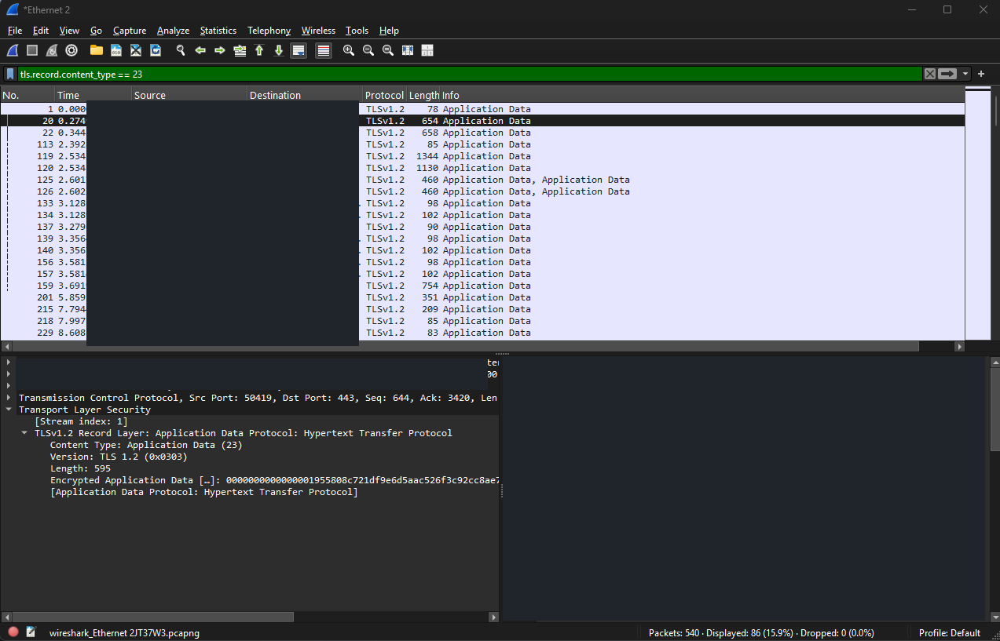

### 5. Network Conversation Analysis

Used Wireshark's Conversations tool to examine communication between different IP addresses.

Sorted IPv4 conversations by total bytes transferred and identified the largest recorded conversation at approximately 44 KB.

Applied a conversation filter to isolate and inspect the packets associated with that communication.

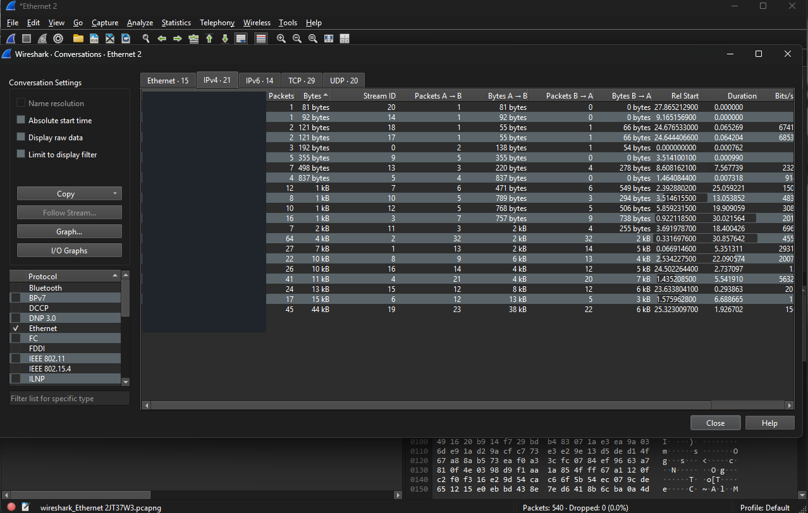

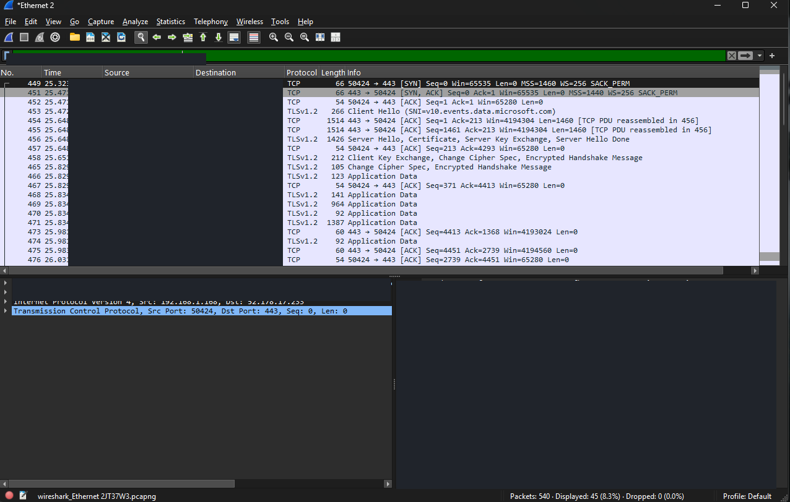

### 6. Protocol Hierarchy Analysis

Used Wireshark's Protocol Hierarchy statistics to examine the protocols present in the recorded traffic.

| Protocol | Percent of Packets |
|---|---:|
| TCP (IPv6 branch) | 8.9% |
| UDP (IPv6 branch) | 13.5% |
| DNS | 5.2% |
| mDNS (IPv6 branch) | 0.2% |
| mDNS (IPv4 branch) | 2.0% |
| TLS (IPv6 branch) | 3.7% |
| TLS (IPv4 branch) | 17.8% |

These percentages represent different branches of the captured protocol hierarchy and should not be added together.

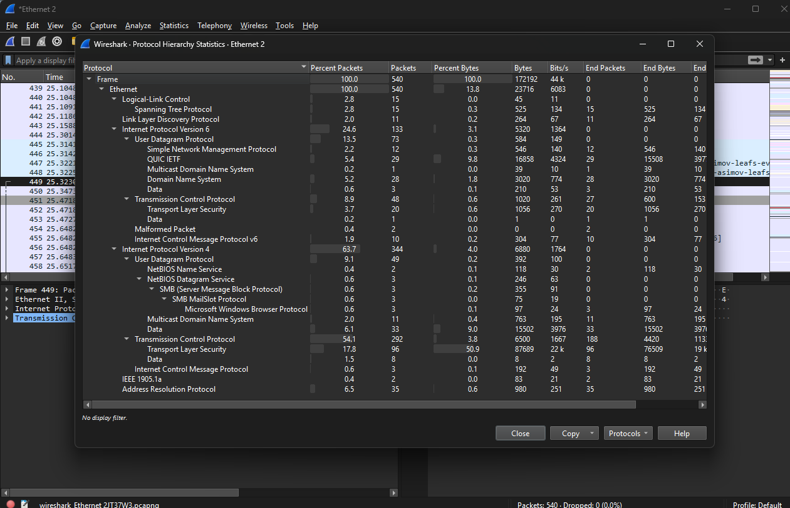

## Wireshark Filters Used

| Filter | Purpose |
|---|---|
| `dns` | Display DNS packets |
| `dns.flags.response == 1` | Identify DNS responses |
| `tcp` | Display TCP traffic |
| `tcp.flags.syn == 1 && tcp.flags.ack == 0` | Identify initial TCP SYN packets |
| `tcp.stream == 11` | Isolate a TCP conversation |
| `tcp.port == 443` | Examine TCP traffic using port 443 |
| `tls` | Identify TLS traffic |
| `tls.record.content_type == 23` | Identify TLS Application Data records |

## What I Learned

This project helped me understand how network communication works beyond simply connecting to the internet.

I gained hands-on experience capturing network traffic, identifying protocols, analyzing DNS lookups, inspecting TCP handshakes, and examining encrypted communication.

I also learned how Wireshark's statistics tools can help identify network communication patterns and narrow down traffic for further investigation.

## Security and Privacy

All traffic was captured from my own authorized network connection. Screenshots were reviewed and redacted before publication. The original packet capture file is stored locally and is not included in this public repository.
